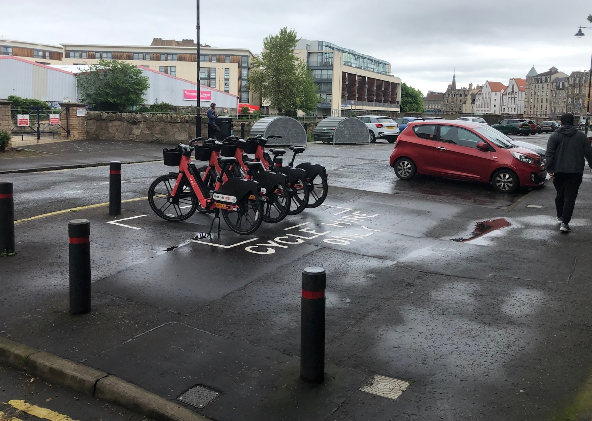

As well as our bi-monthly coverage of the City of Edinburgh Council's **Transport & Environment Committee**, we also keep an eye on cycling-adjacent items at 'full council' meetings; on Thursday 17th September, the council once more convened at the City Chambers. 

There were barely any items on the main agenda relating to our cycling, safer streets and wider transport coverage - but there were a number of interesting bits lurking, as always, in the 'Questions and Answers'.

> 📆 [Meeting Page](https://democracy.edinburgh.gov.uk/ieListDocuments.aspx?CId=150&MId=8107&Ver=4){target="_blank" rel="noopener noreferrer"}   📺 [Webcast](https://edinburgh.public-i.tv/site/mg_bounce.php?mg_a_id=88964&mg_m_id=8107&language=en_GB){target="_blank" rel="noopener noreferrer"}    📑 [Motions & Amendments](https://democracy.edinburgh.gov.uk/documents/b28545/Motions%20and%20Amendments%2017th-Sep-2026%2010.00%20City%20of%20Edinburgh%20Council.pdf?T=9){target="_blank" rel="noopener noreferrer"} [PDF]    🙋🏽 [Questions & Answers](https://democracy.edinburgh.gov.uk/documents/b28544/Questions%20and%20Answers%2017th-Sep-2026%2010.00%20City%20of%20Edinburgh%20Council.pdf?T=9){target="_blank" rel="noopener noreferrer"} [PDF]  

---

### ⬇️ Jump to:

* 🗳️ [**By-elections in Southside/Newington and Craigmillar/Portobello, plus Council Committees**](#7-1-by-elections-3-september-2026-southside-newington-ward-15-and-craigmillar-portobello-ward-17-and-political-composition-of-the-council-and-its-committees) »
* 💸 [**Edinburgh Visitor Levy: New Projects**](#7-7-edinburgh-visitor-levy-new-projects-referral-from-the-transport-and-environment-committee) »
* 🅿️ [**Question: Cycle Hire Only Bays**](#p-10-2-by-councillor-caldwell-cycle-hire-only-bays) »
* 🚲 [**Question: Voi Bike Stations**](#10-7-by-councillor-osler-voi-bike-stations) »
* 💬 [**Question: Communicating Road and Pavement Improvements**](#10-11-by-councillor-ross-communicating-road-and-pavement-improvements) »
* 🌳 [**Question: St Mark's Park Bridge**](#10-12-by-councillor-booth-st-marks-park-bridge) »
* 🚧 [**Question: Road User Charging Discussions**](#10-13-by-councillor-booth-road-user-charging-discussions) »
* 💨 [**Question: The Impact of the LEZ on Air Quality in Edinburgh**](#10-14-by-councillor-booth-the-impact-of-the-lez-on-air-quality-in-edinburgh) »
* 🚋 [**Question: Stabling at Newhaven Terminus**](#10-15-by-councillor-aston-stabling-at-newhaven-terminus) »

---

## 📑 Reports

---

### 🗳️ 7.1 By-elections - 3 September 2026 - Southside/Newington (Ward 15) and Craigmillar/Portobello (Ward 17) and Political Composition of the Council and its Committees

📄 [Report](https://democracy.edinburgh.gov.uk/documents/s103417/Item%207.1%20-%20By-elections%20-%203%20September%202026%20-%20SouthsideNewington%20Ward%2015%20and%20Craigmillar%20-%20Portobel.pdf){target="_blank" rel="noopener noreferrer"} [PDF]

📺 Webcast [from 2h 8m 50s](https://edinburgh.public-i.tv/site/mg_bounce.php?mg_a_id=88977&mg_m_id=8107&language=en_GB){target="_blank" rel="noopener noreferrer"}

This report is a fairly standard bit of business recognising that Ruth Elliot (Labour) has been elected as a Labour councillor for Southside / Newington and that Lorenzo Martinico (Green) has been elected as a councillor for Craigmillar / Portobello. As mentioned previously, both are cyclists and strong proponents of Active Travel - as well as, noted by Council Leader Cllr Jane Meagher in moving the report, two young people - often under-represented in local democracy.

As recognised in the report, the political makeup of committee positions doesn't need to shift based on the new makeup of the council as a result (number of seats held by each party is on page 2).

In seconding, Cllr Mandy Watson pointed out it's a shame for both new Councillors that there's such a short window of time before they'll be back out campaigning again in the 2027 local elections!

Earlier in the meeting - on a business-as-usual item regarding committee appointments - amendments from the Green and Labour groups appointed both new Councillors to the Transport & Environment Committee, replacing Cllr Conor Savage (Labour) and Cllr Ross McKenzie (Green) - so we'll be hearing from them before long! 

As Edinburgh Bus Users Group [quipped on Bluesky](https://bsky.app/profile/edinburghbug.bsky.social/post/3mvskxr62mc2o){target="_blank" rel="noopener noreferrer"} - _"An unusually harsh initiation ritual."_

---

### 💸 7.7 Edinburgh Visitor Levy: New Projects - referral from the Transport and Environment Committee

📄 [Report](https://democracy.edinburgh.gov.uk/documents/s103587/Item%207.7%20-%20Edinburgh%20Visitor%20Levy%20-%20New%20Projects%20-%20referral%20from%20the%20Transport%20and%20Environment%20Commi.pdf){target="_blank" rel="noopener noreferrer"} [PDF]

📺 Webcast [from 3h 34m 35s](https://edinburgh.public-i.tv/site/mg_bounce.php?mg_a_id=89378&mg_m_id=8107&language=en_GB){target="_blank" rel="noopener noreferrer"}

This item returns the list of 'Visitor Levy'-funded projects under the Transport Committee's purview back to full council for final approval, including transport links for the Edinburgh International Climbing Arena and Lost Shore Surf resort in Ratho, funding for public realm works on Princes Street and George Street, and funding at long last for [The Causey](https://thecausey.org/){target="_blank" rel="noopener noreferrer"}, who have relentlessly fought for a more habitable public space for residents and visitors on their patch at West Crosscauseway - since 2007! 

This item passed without amendment or much fanfare, save for the first contribution of new councillor Ruth Elliot for Labour, and we were delighted to see a classic Edinburgh active travel proponent statistic rolled out in her seconding of the report:

> _"As everyday life becomes more and more expensive, it is so important that there are spaces in the city where people can spend time without spending money._
> 
> _"The Causey have been holding community events for over a decade and transforming this space would allow people to convene more spontaneously and more safely without the traffic coming through._ 
>
> _"As one of the 38% of Edinburgh's households who do not own a car, I understand how important it is to make safe routes and safe spaces for walking, cycling, wheelchair users and parents with buggies._
>
> _"I think this is a fantastic project, and it will bring huge benefits to the Southside."_ — Cllr Ruth Elliot 

---

## 🙋🏽 Questions & Answers

Questions are submitted ahead of the meeting and answered on paper by the relevant committee Convener and Council Officers; they're not debated or discussed in the meeting itself.

---

### 🅿️ 10.2 By Councillor Caldwell - Cycle Hire Only Bays

📄 [Question & Answer](https://democracy.edinburgh.gov.uk/documents/b28544/Questions%20and%20Answers%2017th-Sep-2026%2010.00%20City%20of%20Edinburgh%20Council.pdf?T=9#page=6){target="_blank" rel="noopener noreferrer"} [PDF, page 6]

You might be aware of [our campaign to get Voi hire bikes out of cycle parking](https://edi.bike/projects/2025-11-voi-cycle-rack-parking/) - as well as our contributions to the 'teething issues' stakeholder workshop held earlier this year.

One of the biggest factors in this being dealt with - along with being the solution to a host of other accessibility, pedestrian space and 'clutter' issues caused by the geofenced docking 'zones' not being as narrow as would be ideal - has been a trial of marked, painted zones for parking the hire cycles in. 

<figure>
  
  <figcaption>Image: City of Edinburgh Council</figcaption>
</figure>

At the time of the stakeholder workshop, this was a limited trial of around 22 spaces. However, according to the answer on this item, the Council hopes to paint zone markings at a total of **one hundred parking locations by the end of 2026** - which is fantastic news in moving towards mitigating the few issues an otherwise very successful and useful scheme has created.

---

### 🚲 10.7 By Councillor Osler - Voi Bike Stations 

📄 [Question & Answer](https://democracy.edinburgh.gov.uk/documents/b28544/Questions%20and%20Answers%2017th-Sep-2026%2010.00%20City%20of%20Edinburgh%20Council.pdf?T=9#page=13){target="_blank" rel="noopener noreferrer"} [PDF, page 13]

A question like this a full year into the trial of the hire bike scheme in Edinburgh feels... odd. 

The Council officers at the helm of rolling out the scheme and interfacing with supplier **Voi** are highly approachable, proactive and receptive to feedback — _one might imagine even more so to enquiries from Councillors!_ — and we'd felt many aspects of this question were already somewhat in the public domain.

But, it's on the record now. Feels like a classic Lib Dem wedge issue approach - we'll help you complain about those ghastly electric bicycles everyone but you seems to be having fun on? The reality is that the majority of parking locations for the scheme have been carefully picked out in liaison with the council so as to not elicit complaints from residents, so...

---

### 💬 10.11 By Councillor Ross - Communicating Road and Pavement Improvements 

📄 [Question & Answer](https://democracy.edinburgh.gov.uk/documents/b28544/Questions%20and%20Answers%2017th-Sep-2026%2010.00%20City%20of%20Edinburgh%20Council.pdf?T=9#page=20){target="_blank" rel="noopener noreferrer"} [PDF, page 20]

Interesting to hear of plans to better communicate investment and maintenance — in the form of road resurfacing or other conditioning / patching projects — as a map on the council's website in the near future.

---

### 🌳 10.12 By Councillor Booth - St Mark's Park Bridge 

📄 [Question & Answer](https://democracy.edinburgh.gov.uk/documents/b28544/Questions%20and%20Answers%2017th-Sep-2026%2010.00%20City%20of%20Edinburgh%20Council.pdf?T=9#page=21){target="_blank" rel="noopener noreferrer"} [PDF, page 21]

---

### 🚧 10.13 By Councillor Booth - Road User Charging Discussions 

📄 [Question & Answer](https://democracy.edinburgh.gov.uk/documents/b28544/Questions%20and%20Answers%2017th-Sep-2026%2010.00%20City%20of%20Edinburgh%20Council.pdf?T=9#page=22){target="_blank" rel="noopener noreferrer"} [PDF, page 22]

---

### 💨 10.14 By Councillor Booth - The Impact of the LEZ on Air Quality in Edinburgh

📄 [Question & Answer](https://democracy.edinburgh.gov.uk/documents/b28544/Questions%20and%20Answers%2017th-Sep-2026%2010.00%20City%20of%20Edinburgh%20Council.pdf?T=9#page=23){target="_blank" rel="noopener noreferrer"} [PDF, page 23]

---

### 🚋 10.15 By Councillor Aston - Stabling at Newhaven Terminus

📄 [Question & Answer](https://democracy.edinburgh.gov.uk/documents/b28544/Questions%20and%20Answers%2017th-Sep-2026%2010.00%20City%20of%20Edinburgh%20Council.pdf?T=9#page=24){target="_blank" rel="noopener noreferrer"} [PDF, page 24]

---

✨ **Donate to edi.bike:** 
